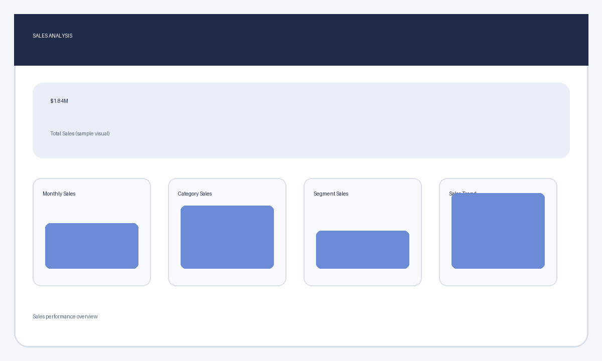
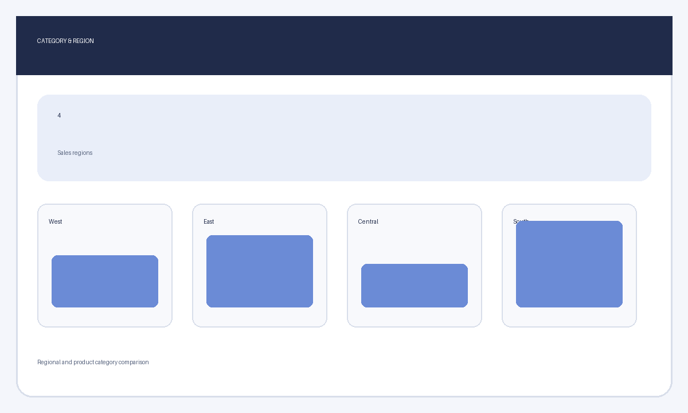

# Superstore Sales & Profitability Dashboard

## Project Overview
This project focuses on analyzing sales and profitability across different product categories, regions, and customer segments using data analytics and visualization techniques.

The objective is to identify sales trends, evaluate business performance, and discover opportunities to improve profitability.

## Objectives
- Analyze overall sales and profit performance
- Identify top-performing product categories
- Compare sales across different regions
- Analyze the impact of discounts on profitability
- Identify loss-making products and business opportunities
- Present insights through an interactive dashboard

## Tools & Technologies
- Python
- Pandas
- NumPy
- SQL
- Excel
- Power BI
- Matplotlib
- Seaborn

## Project Workflow
1. Data Overview
2. Data Cleaning & Preprocessing
3. Sales Analysis
4. Profitability Analysis
5. Category & Regional Analysis
6. Dashboard Development
7. Business Insights & Recommendations

## Dashboard Preview

### Data Overview

### Sales Analysis

### Profit Analysis

### Category & Region Analysis

### Power BI Dashboard

### Business Insights

## Key Areas of Analysis
- Sales performance
- Profitability trends
- Category-wise sales
- Region-wise performance
- Discount analysis
- Product performance

## Author
Soham Sutar

[GitHub](https://github.com/soham2142)
